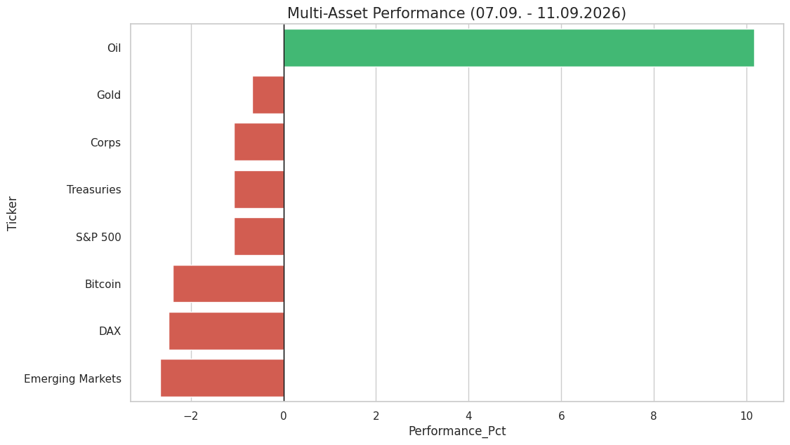

# 📈 Multi-Asset Weekly Wrap-up

## Aktueller Wochenrückblick (2026-10-09)

### Markt-Kontext & Analyse
| Asset | Performance | Trend (4W) | Risiko-Status |
| :--- | :--- | :--- | :--- |
| Oil | +2.30% | ➡️ | ✅ Stabil |
| Corps | +0.63% | ➡️ | 🔄 Volatil |
| Treasuries | +0.60% | ➡️ | 🔄 Volatil |
| Gold | +0.00% | ➡️ | ✅ Stabil |
| S&P 500 | -0.11% | ➡️ | ✅ Stabil |
| DAX | -1.77% | ➡️ | 🔄 Volatil |
| Emerging Markets | -3.83% | ➡️ | 🔄 Volatil |
| Bitcoin | -4.79% | ➡️ | ✅ Stabil |

---
*Automatisch aktualisiert am 10.10.2026 um 00:28*
