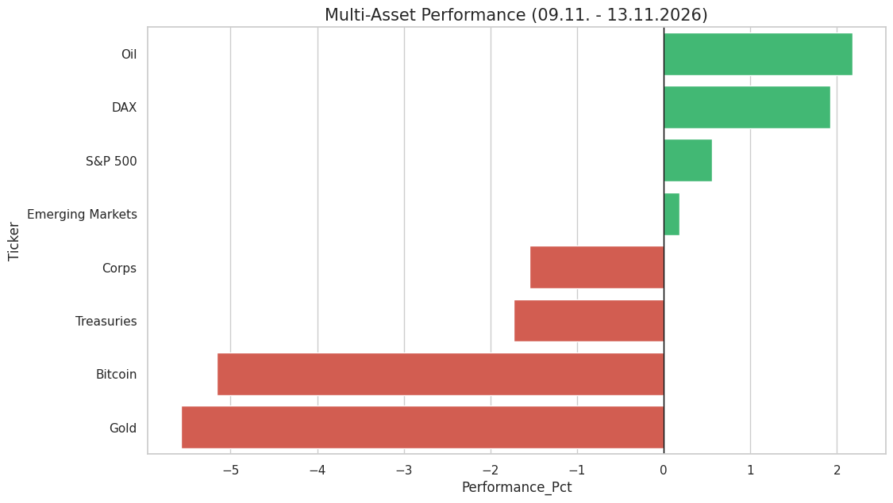

# 📈 Multi-Asset Weekly Wrap-up

## Aktueller Wochenrückblick (2026-11-13)

### Markt-Kontext & Analyse
| Asset | Performance | Trend (4W) | Risiko-Status |
| :--- | :--- | :--- | :--- |
| Oil | +2.18% | ➡️ | ✅ Stabil |
| DAX | +1.92% | ➡️ | 🔄 Volatil |
| S&P 500 | +0.56% | ➡️ | ✅ Stabil |
| Emerging Markets | +0.18% | ➡️ | ✅ Stabil |
| Corps | -1.55% | ➡️ | ⚠️ Extrem |
| Treasuries | -1.73% | ➡️ | ⚠️ Extrem |
| Bitcoin | -5.16% | ➡️ | 🔄 Volatil |
| Gold | -5.57% | ➡️ | ⚠️ Extrem |

---
*Automatisch aktualisiert am 14.11.2026 um 01:14*
